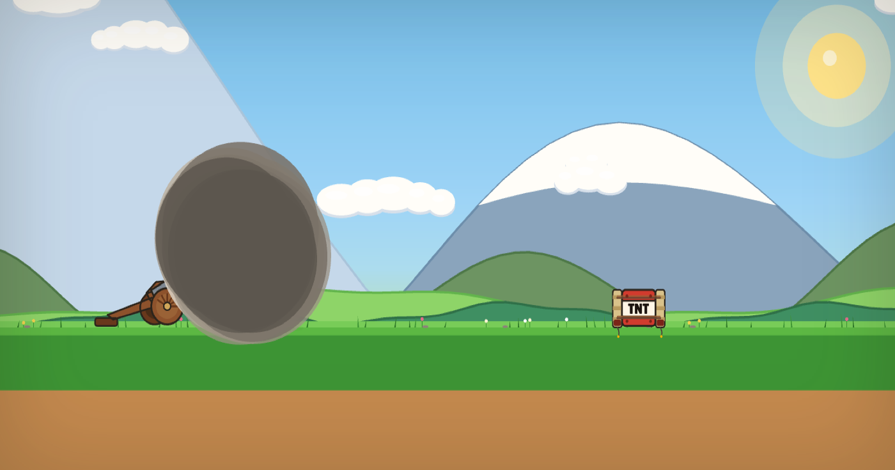

# Kitten Cannon

Aim the barrel, fire when the power bar is full, and see how far the kitty flies.

**[Play the game](https://pdobb.github.io/kitten-cannon/)**



## Where it comes from

This is a vibe-coded [PixiJS](https://pixijs.com/) tribute to *Kitten Cannon!*, the Flash game [Dan Fleming](https://www.newgrounds.com/portal/view/228520) posted on Newgrounds as BurstStudio on March 30, 2005. Up and down aimed the cannon, space fired, and a red meter set the power. Balloons, bombs, and trampolines threw the kitten farther. Tar pits and the flytrap ended the ride. The score was distance in feet. It became the game people point to when they talk about the toss games that followed on Newgrounds. The picture is flat on purpose: the grass, the foothills, and the mountains share one horizon, and the flight numbers are the same.

The flight here follows that game's 2007 v1.3 frame: gravity of 1 pixel per frame at 30 frames a second, a bounce of 0.72, and feet equal to horizontal pixels divided by 30. The kitten, the field, the mountains, and the sound are drawn and synthesized for this version.

## Develop

From this folder:

```bash
npm install
npm run dev
```

Open [http://localhost:5173/](http://localhost:5173/). The dev server listens on localhost. `http://127.0.0.1:5173/` will not connect.

```bash
npm test          # checks the flight numbers
npm run build     # writes one HTML file and copies it to docs/
npm run preview   # serves that build
```

GitHub Pages serves `docs/index.html` at the play link above. The Vite entry stays `index.html`. Leave the source file alone when you publish. `docs/kitten_cannon.html` only redirects to `./`.

On a phone, open the play link in the browser. A texted HTML file is only a preview, and the game will not start from it. Open the play link once while you are online, then add it to the home screen. After that the game runs with the network off, fonts included. Arrows aim. Enter or Space fires, and fires again after a landing. R rebuilds the field without leaving the game or full screen. M mutes. A touch screen can swipe up or down to aim and tap the field to fire.

Issues welcome.
